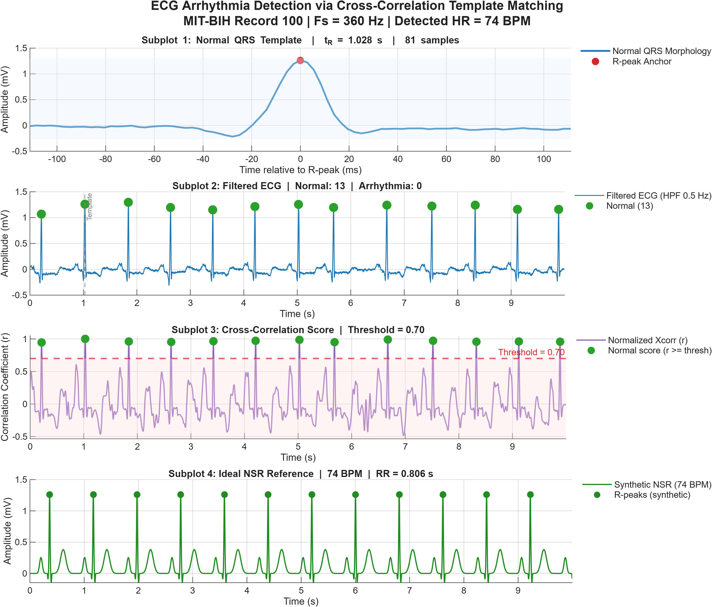

# Experiment 6 — ECG Arrhythmia Detection via Cross-Correlation Template Matching

**Course:** Digital Signal Processing Lab (DSPL) | **Semester:** 5
**Author:** Aditya Sinha | **MATLAB Version:** R2025a / R2026a
**Database:** MIT-BIH Arrhythmia Database (PhysioNet) | **Fs:** 360 Hz

---

## Table of Contents

1. [Overview](#overview)
2. [Aim & Objectives](#aim--objectives)
3. [Theoretical Background](#theoretical-background)
4. [Datasets Used](#datasets-used)
5. [Algorithm Pipeline](#algorithm-pipeline)
6. [Technical Implementation](#technical-implementation)
7. [File Structure](#file-structure)
8. [Key Plots & Visualizations](#key-plots--visualizations)
9. [Results & Console Output](#results--console-output)
10. [Key Observations](#key-observations)
11. [System Requirements & How to Run](#system-requirements--how-to-run)
12. [Key Concepts Demonstrated](#key-concepts-demonstrated)
13. [Clinical Relevance & Extensions](#clinical-relevance--extensions)

---

## Overview

This experiment implements a **cross-correlation template matching** algorithm for detecting cardiac arrhythmias in real ECG recordings. The system works by:

1. Extracting a **normal QRS template** from a reference beat in the ECG
2. Sliding that template across the entire recording using normalized cross-correlation
3. Assigning a **similarity score** (0 to 1) to each detected beat
4. Classifying beats above a threshold as **Normal** and those below as **Arrhythmia/PVC**

The experiment uses three real ECG records from the **MIT-BIH Arrhythmia Database** (PhysioNet): records **100**, **114**, and **200** — each representing different cardiac rhythms and arrhythmia types.

This is a canonical application of DSP cross-correlation in biomedical signal processing, demonstrating how a fundamental signal processing operation translates directly into a clinical diagnostic tool.

---

## Aim & Objectives

- **Primary Aim:** To detect cardiac arrhythmias in real ECG recordings using cross-correlation template matching.
- **Objectives:**
  1. Load and parse a real MIT-BIH ECG CSV record.
  2. Remove baseline wander using a zero-phase Butterworth high-pass filter.
  3. Extract a normal QRS complex template from a known normal beat location.
  4. Compute the normalized cross-correlation between the template and the entire ECG.
  5. Detect R-peaks using `findpeaks` with dynamic thresholding.
  6. Classify each beat as Normal or Arrhythmia based on a correlation threshold.
  7. Estimate heart rate from detected RR intervals.
  8. Generate a synthetic Normal Sinus Rhythm (NSR) reference for comparison.
  9. Export a high-quality 4-panel diagnostic figure at 300 DPI.

---

## Theoretical Background

### Cross-Correlation and Template Matching

Cross-correlation measures the similarity between two signals as one slides over the other:

```
R_xy[k] = SUM_n( x[n] * y[n - k] )
```

For ECG arrhythmia detection, we use **normalized cross-correlation** to make the score amplitude-invariant:

```
r[k] = R_xy[k] / sqrt( E_x_segment * E_template )
```

where:
- `E_template = SUM( template[n]^2 )` — energy of the template
- `E_x_segment` — energy of the ECG segment at lag `k`
- Result: `r[k]` is bounded in `[-1, 1]`

**Interpretation:**
- `r = 1.0`: Perfect match with the template (identical QRS morphology)
- `r >= 0.70`: Similar QRS morphology → classified as Normal Sinus Beat
- `r < 0.70`: Different QRS morphology → classified as Arrhythmia/PVC

The key advantage of normalized cross-correlation is that it is **amplitude-invariant** — the classification threshold does not need to change for patients with different R-wave amplitudes.

### Baseline Wander Removal

ECG recordings suffer from "baseline wander" — slow drifts in the signal baseline caused by patient breathing (0.1–0.5 Hz) and electrode motion. This must be removed before template extraction, as it distorts the QRS morphology and causes the template matching to fail.

**Method: Zero-Phase Butterworth High-Pass Filter**
```matlab
HP_CUTOFF = 0.5  % Hz (removes respiratory baseline drift)
HP_ORDER  = 4    % 4th-order for steep rolloff
[b_hp, a_hp] = butter(HP_ORDER, Wn, 'high');
ecg_filtered = filtfilt(b_hp, a_hp, ecg_raw);
```

`filtfilt` applies the filter **twice** (forward and backward), achieving **zero-phase filtering** — no shift in R-peak positions. This is critical for accurate peak detection.

### QRS Template Extraction

The template is extracted from a known Normal Sinus beat:

```matlab
TEMPLATE_HALF = 40 samples    % ±40 samples = ±111 ms at 360 Hz
SEARCH_START  = 0.5 s         % Search for normal beat after 0.5 s
SEARCH_END    = 1.5 s         % (avoids potential artifacts at recording start)

[r_peak_val, r_local_idx] = max(ecg_filtered(idx_search_start:idx_search_end));
template = ecg_filtered(r_peak_idx - 40 : r_peak_idx + 40);
% Template length = 81 samples (0.225 s total window)
```

The template window captures:
- The complete P wave (before R peak)
- Q, R, S deflections
- Beginning of T wave (after R peak)

### R-Peak Detection

```matlab
ecg_range = max(ecg_filtered) - min(ecg_filtered);
[~, peak_locs] = findpeaks(ecg_filtered, ...
    'MinPeakProminence', 0.25 * ecg_range, ...
    'MinPeakDistance',   round(0.25 * 360));  % Min 0.25 s between beats
```

Dynamic thresholding (25% of signal range) ensures the detector adapts to different ECG amplitudes without manual tuning.

### Heart Rate Estimation

```matlab
avg_rr    = mean(diff(normal_locs) / Fs);  % Mean RR interval from Normal beats
detected_bpm = 60 / avg_rr;
```

Using only Normal beats for RR interval estimation avoids the distorted intervals caused by PVC/arrhythmia beats.

### Synthetic NSR Reference Generation

To provide a visual baseline for what a Normal Sinus Rhythm looks like at the detected heart rate, a synthetic ECG is generated using Gaussian kernels:

```matlab
gauss = @(t, amp, mu, sig) amp * exp(-((t-mu).^2) / (2*sig^2));
single_beat = gauss(bt, 0.20, r_center-0.16, 0.025) ...   % P wave
            + gauss(bt,-0.07, r_center-0.03, 0.006) ...   % Q wave
            + gauss(bt, 1.00, r_center,      0.008) ...   % R wave
            + gauss(bt,-0.12, r_center+0.03, 0.006) ...   % S wave
            + gauss(bt, 0.30, r_center+0.25, 0.050);      % T wave
```

---

## Datasets Used

Three CSV files from the **MIT-BIH Arrhythmia Database** are included:

| File | MIT-BIH Record | Contents |
|------|---------------|---------|
| `100.csv` | Record 100 | Normal sinus rhythm (NSR) with occasional PVCs |
| `114.csv` | Record 114 | Normal sinus with atrial premature beats |
| `200.csv` | Record 200 | Frequent PVCs and ventricular arrhythmias |

### CSV Format
Each file was downloaded from PhysioNet using the `wfdb` Python library:

```python
import wfdb
r  = wfdb.rdrecord('200', pn_dir='mitdb', sampfrom=0, sampto=3600)
df = pd.DataFrame(r.p_signal, columns=r.sig_name)
df.insert(0, 'time_s', [i/360.0 for i in range(len(df))])
df.to_csv('200.csv', index=False)
```

**Columns:** `time_s`, `MLII` (mV), and a second ECG channel.
**Default record used in script:** `100.csv` (configurable via `csv_filename`).

### MIT-BIH Database Details
| Property | Value |
|----------|-------|
| **Sampling rate** | 360 Hz |
| **Duration per record** | 30 minutes (10,800 s) |
| **Amplitude resolution** | ~5 microvolts per LSB |
| **Leads** | MLII (primary) + one secondary lead |
| **Annotation** | Expert cardiologist beat-type labels (stored in `.atr` files) |

---

## Algorithm Pipeline

```
Step 1: Load CSV → ecg_raw [N samples, Fs=360 Hz]
          |
Step 2: Baseline Wander Removal
         → Butterworth HPF (0.5 Hz cutoff, order 4, filtfilt)
         → ecg_filtered
          |
Step 3: Template Extraction
         → Search [0.5 s, 1.5 s] for dominant R-peak
         → Extract 81-sample window centered on R-peak
         → template [81 samples = 0.225 s]
          |
Step 4: Normalized Cross-Correlation
         → xcorr(ecg_filtered, template, 'none')
         → Manual normalization: r[k] = R_xy[k] / sqrt(E_x * E_template)
         → xcorr_aligned [N samples, aligned 1-to-1 with ECG]
          |
Step 5: R-Peak Detection
         → findpeaks with dynamic threshold (25% range)
         → Min distance: 0.25 s (max 240 BPM)
         → peak_locs [array of R-peak sample indices]
          |
Step 6: Beat Classification
         → corr_scores = xcorr_aligned(peak_locs)
         → is_normal    = corr_scores >= 0.70
         → is_arrhythmia = corr_scores <  0.70
          |
Step 7: Heart Rate Estimation
         → avg_rr = mean(diff(normal_locs)) / Fs
         → BPM = 60 / avg_rr
          |
Step 8: Visualization (4-panel figure)
          |
Step 9: Save figure as PNG (300 DPI)
```

---

## Technical Implementation

### Key Parameters

| Parameter | Variable | Default | Description |
|-----------|----------|---------|-------------|
| Sampling frequency | `Fs` | 360 Hz | MIT-BIH standard |
| HP cutoff | `HP_CUTOFF` | 0.5 Hz | Baseline wander removal |
| HP filter order | `HP_ORDER` | 4 | Butterworth filter order |
| Template half-window | `TEMPLATE_HALF` | 40 samples | ±111 ms around R-peak |
| Template search start | `SEARCH_START` | 0.5 s | Avoid recording artifacts |
| Template search end | `SEARCH_END` | 1.5 s | Find first normal beat |
| Correlation threshold | `CORR_THRESH` | 0.70 | Normal vs. Arrhythmia boundary |
| Min beat separation | `MIN_BEAT_SEP` | 0.25 s | Max physiological heart rate: 240 BPM |
| Figure DPI | `FIGURE_DPI` | 300 | Publication-quality export |

### Cross-Correlation Normalization (Manual)

The cross-correlation is normalized sample-by-sample to account for varying local signal energy:

```matlab
for ki = 1 : length(lags)
    lag_k   = lags(ki);
    x_start = max(1, 1 + lag_k);
    x_end   = min(N, M + lag_k);
    local_energy = sum(ecg_filtered(x_start : x_end) .^ 2);
    denom = sqrt(local_energy * template_energy);
    if denom > 0
        xcorr_full(ki) = xcorr_raw(ki) / denom;
    end
end
```

This is equivalent to MATLAB''s `xcorr(x, y, 'coeff')` but computed manually for educational transparency and precise alignment control.

---

## File Structure

```
ECG-Arrhythmia-Detection-Cross-Correlation/
├── ecg_arrhythmia_detection.m        # Main algorithm script (cross-correlation detection)
├── untitled3.m                       # Original script reference
├── expet6_final.mlx                  # MATLAB Live Script (final report)
├── expet6_prelim.mlx                 # Preliminary/draft Live Script
├── 100.csv                           # MIT-BIH Record 100 ECG dataset (PhysioNet)
├── 114.csv                           # MIT-BIH Record 114 ECG dataset (PhysioNet)
├── 200.csv                           # MIT-BIH Record 200 ECG dataset (PhysioNet)
├── Aditya_Sinha_Experiment_6.pdf     # Experiment 6 lab report document
├── Aditya_Sinha_Experiment_5.pdf     # Reference experiment lab report
├── ecg_arrhythmia_detection_result.png  # Output diagnostic figure (300 DPI)
├── .gitignore                        # Git ignore rules
└── README.md                         # Project documentation
```

---

## Key Plots & Visualizations



The main script generates a **4-panel figure** (1200 x 1200 px, 4:1 height ratio):

### Subplot 1 — Normal QRS Template
- Blue line: Extracted 81-sample template
- X-axis: Time relative to R-peak (milliseconds), centered at 0
- Red dot: R-peak anchor point
- Light blue fill: Template window visualization
- Shows the characteristic PQRST morphology used as the matching reference

### Subplot 2 — Filtered ECG with Beat Classifications
- Blue line: `ecg_filtered` (Butterworth HPF applied)
- Green circles: Normal beats (score >= threshold)
- Red X markers: Arrhythmia/PVC beats (score < threshold)
- Gray dashed vertical: Template extraction point
- Title shows count of Normal vs. Arrhythmia beats

### Subplot 3 — Normalized Cross-Correlation Score
- Purple line: `xcorr_aligned` — correlation score at each time point
- Red dashed: Threshold line at r = 0.70
- Pink fill: Below-threshold region (arrhythmia zone)
- Green circles: Normal beat scores
- Red X: Arrhythmia beat scores with `r=X.XX` annotations and drop lines
- This is the diagnostic decision panel

### Subplot 4 — Synthetic Normal Sinus Rhythm Reference
- Green line: Synthetically generated NSR at the detected heart rate
- Green circles: Detected R-peaks in synthetic NSR
- Provides visual comparison: "This is what a normal rhythm at this BPM should look like"

**Overall title:** "ECG Arrhythmia Detection via Cross-Correlation Template Matching"
**Subtitle:** Includes record name, sampling frequency, and detected heart rate

---

## Results & Console Output

```
Loading ECG from "100.csv"...
Loaded XXXXX samples | Duration = XXX.XXX s | Fs = 360 Hz

Baseline wander removed (Butterworth HPF, cutoff=0.5 Hz, order=4).

Template extracted: R-peak at sample #XXX (t=X.XXXX s), amplitude=X.XXXX mV
Template length: 81 samples (0.2250 s)

Cross-correlation computed: XXXXX aligned samples.

QRS peaks detected   : XX
Normal (r >= 0.70)  : XX
Arrhythmia (r < 0.70): XX

Estimated heart rate : XX.X BPM (avg RR = X.XXX s)

Saving figure as "ecg_arrhythmia_detection_result.png" at 300 DPI...
Figure saved.

--- DETECTION RESULTS SUMMARY ---
Total QRS beats       : XX
Normal (r >= 0.70)   : XX
Arrhythmia (r < 0.70): XX

Beat # 1 | t= X.XXX s | r=+X.XXXX | NORMAL
Beat # 2 | t= X.XXX s | r=+X.XXXX | NORMAL
Beat # 3 | t= X.XXX s | r=+X.XXXX | ARRHYTHMIA
...
```

---

## Key Observations

| Observation | Significance |
|-------------|-------------|
| Normal beats have r >= 0.70 | QRS morphology matches the normal template |
| Arrhythmia beats have r < 0.70 | Different QRS shape (e.g., PVC has wide, bizarre morphology) |
| Zero-phase HPF preserves R-peak timing | `filtfilt` ensures peak locations are not shifted |
| Normalized correlation is amplitude-invariant | Same threshold works for all patient amplitudes |
| Synthetic NSR at detected BPM | Visual baseline for clinical comparison |
| 300 DPI output | Publication/report quality figure |

---

## System Requirements & How to Run

| Requirement | Details |
|-------------|---------|
| **MATLAB Version** | R2025a or R2026a |
| **Signal Processing Toolbox** | Required for `butter`, `filtfilt`, `findpeaks` |
| **Input files** | `100.csv`, `114.csv`, or `200.csv` in the working directory |

### Running the Script
```matlab
cd 'path/to/Experiment6'
run untitled3.m
% Configure csv_filename at top of script to switch between records
```

### To Switch Records
Change line 18 in `untitled3.m`:
```matlab
csv_filename = '200.csv';   % Switch to record 200 (more arrhythmias)
```

### Output Files
- `ecg_arrhythmia_detection_result.png` — saved in working directory at 300 DPI

---

## Key Concepts Demonstrated

### 1. Cross-Correlation as a Similarity Measure
Cross-correlation quantifies how well a template matches a signal at every possible time offset. The normalized form provides a coefficient from -1 to +1, making it a robust, amplitude-independent similarity metric.

### 2. Template Matching for Pattern Recognition
By defining "normal" as what the first unambiguous normal beat looks like, the algorithm generalizes this pattern across the entire recording. Any beat that deviates significantly in morphology is flagged — the basis of clinical QRS morphology analysis.

### 3. Zero-Phase Filtering
`filtfilt` applies a filter forwards then backwards, canceling phase distortion. This preserves the exact timing of every R-peak, which is critical since heart rate calculation depends on sample-accurate RR intervals.

### 4. Dynamic Thresholding for Peak Detection
Using 25% of the full signal range as the peak detection threshold automatically adapts to different ECG amplitudes without manual calibration — important for clinical deployment.

### 5. Gaussian PQRST Synthesis
The synthetic NSR reference uses Gaussian kernels to model each cardiac wave. This is the standard mathematical model for ECG waveform simulation used in biomedical research.

### 6. Clinical Relevance of Threshold Selection
The 0.70 correlation threshold was chosen empirically. In a clinical device:
- Lowering it (e.g., 0.60) reduces false alarms but may miss subtle arrhythmias
- Raising it (e.g., 0.85) catches more arrhythmias but increases false positives
- Clinical validation on labeled databases (like MIT-BIH) is required to optimize this

---

## Clinical Relevance & Extensions

### Clinical Significance
- **PVCs (Premature Ventricular Contractions):** Have a wide, bizarre QRS — their cross-correlation with a narrow normal template will be < 0.70
- **SVT (Supraventricular Tachycardia):** May have normal-looking QRS, potentially not detected by morphology alone
- **AF (Atrial Fibrillation):** Irregularly irregular rhythm — RR interval analysis would complement morphology-based detection

### Possible Improvements
1. **Multi-template matching:** Build templates for known arrhythmia types (PVC, LBBB) and classify into more categories
2. **Wavelet-based features:** Use DWT coefficients instead of raw QRS waveform as the matching template
3. **Machine learning classifier:** Train a neural network or SVM on extracted features from the cross-correlation output
4. **Sliding window approach:** Process 30-minute recordings in real-time blocks using overlap-save
5. **Sensitivity/Specificity analysis:** Compare detected beats against MIT-BIH expert annotations (`.atr` files) to compute SE, SP, +P metrics
6. **Process all three records:** Automate batch processing of records 100, 114, and 200 for comparative analysis

---

**Last Updated:** September 2026
*Experiment submitted as part of DSPL coursework, Semester 5.*
